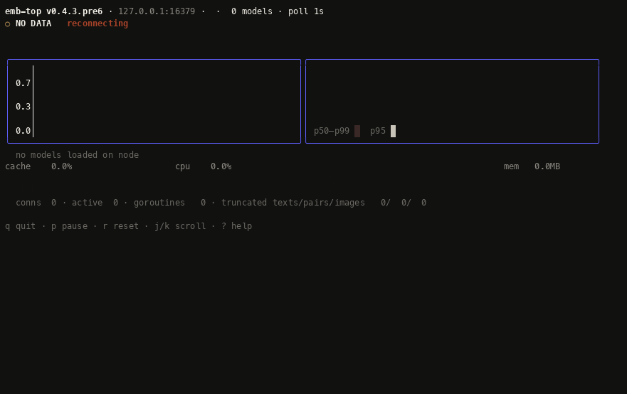
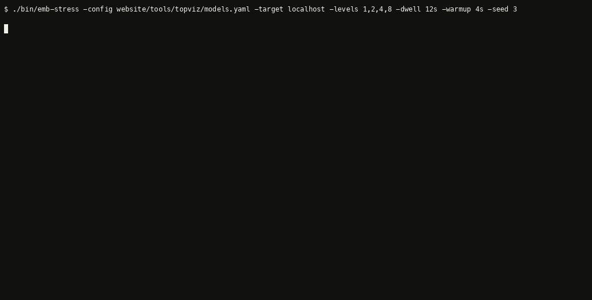

# Operations

## Health checks

`EMB.READY` returns `+OK` when the server is ready to serve traffic, or `-ERR`
with a reason (`loading`, `draining`, `no models`). Point your load balancer's
TCP health check at it, or use the client's `ready?`/`ready` helpers:

```bash
redis-cli EMB.READY
# → OK
```

```ruby
Emb.ready?  # => true
Emb.ready   # => "ready"
```

`EMB.READY` is the process state: "ready" once every model configured for
preload has decided layout. It is not a per-model warranty — a model left lazy
is laid out on first use, and `EMB.MODELS` reports each model's own answer:

| Status | Meaning |
|---|---|
| `ready` | the embedding layout is decided; requests are served |
| `loading` | the layout is being decided now, off the request path |
| `uninitialized` | lazy and not yet asked for anything (never preloaded) |
| `failed: …` | initialization failed; the reason follows |

A request for a model whose layout is undecided is answered
`ERR not ready: model "x" is initializing` instead of waiting for calibration, so
a cold model cannot park the request path — the first requests after a cold boot
of a lazy model are refusals, and they succeed once `EMB.MODELS` reports
`ready`. Configure `preload: true` for a model on a serving path if you would
rather pay that cost at boot.

## Connection lifecycle

Three knobs bound the server's connection and request surface. `idle_timeout`
defaults to **15 minutes** (set `0` to disable reaping entirely); the two caps
default to `0` (unlimited).

```yaml
idle_timeout: 15m
max_connections: 100
max_concurrent_requests: 32
```

Equivalent flags: `-idle-timeout 15m`, `-max-connections 100`,
`-max-concurrent-requests 32`.

- `idle_timeout` reaps connections that stop sending commands, bounding file
  descriptors and zombie-diagnosis noise. Pooled Redis clients reconnect
  transparently; a long-idle interactive session is closed and must reconnect.
- `max_connections` refuses connections at the cap; refused sockets are closed
  immediately without being counted.
- `max_concurrent_requests` answers `EMB`/`EMB.MULTI` with `ERR busy ...` while
  at the cap, giving consumers backpressure instead of unbounded queueing.
  Control commands (`PING`, `AUTH`, `EMB.READY`, `EMB.STATS`, `EMB.MODELS`,
  `EMB.INFO`, `EMB.HELP`) always answer so ops can still probe a saturated
  server.

## Observability

`EMB.STATS` reports uptime, total requests, live `connections` and
`active_requests` (the real in-flight count), a per-model breakdown
(requests, avg latency, tokens, errors, pooling), live process resources
(`mem` = RSS MB, `cpu_user_usec`/`cpu_sys_usec`, `goroutines`), the cache
counters, and the effective
`idle_timeout_ms`/`max_connections`/`max_concurrent_requests` — a 10-second
check to classify a CPU/stuck-traffic incident as volume, saturation, or
churn (and to confirm no memory leak: RSS/goroutines flat between polls).

### Dispatch and run counters

`EMB.INFO <model>` and the per-model lines of `EMB.STATS` report, separately for
the script path (`script_*`) and the embedding path (`embed_*`):

- `dispatch_wait_us` — cumulative time requests spent waiting for a free
  session or worker
- `run_us` — cumulative ORT inference time
- `runs` — inference runs
- `sessions_busy` / `sessions_total` — live session occupancy

All are cumulative except the gauges, and reads are atomic. Derive an average
from two reads: `(wait_us₂ − wait_us₁) / (runs₂ − runs₁)` is the mean dispatch
wait per run, and the same for `run_us`. A serial workload keeps the mean wait
near zero; when concurrency exceeds `sessions_total`, the wait grows and
`sessions_busy` sits at `sessions_total`. A rising `run_us` at flat load points
at CPU contention (see the thread budget in
[configuration](./configuration.md#thread-budget)).

`MONITOR [seq] [limit]` exposes the last completed-request events (up to 8192,
oldest evicted) for per-request visibility: latency percentiles, error and
volume attribution per model, and each request's own path and phases. It is named
after Redis's `MONITOR` but is a bounded sequence-query rather than a long-lived
stream — pass the last `seq` you saw to fetch only newer events, which is how
[`emb-top`](#monitoring-emb-top) keeps its cost near zero. Request texts are
never included.

Every event carries `cached_texts` (how many of its texts the reply cache
answered) and, when the server measured them, `dispatch_us`, `admit_us` and
`run_us`: the time that request's *uncached* texts spent waiting for a session or
batch window, waiting at the process CPU gate, and running. `attributed` says
whether those phases were measured at all — a request served outside the
embedding pool (an image run on its own tensor sessions) reports `attributed 0`
with zero phases, which is absent attribution, not a free run. The phases never
sum to more than the request's `latency_us`: whatever the latency includes beyond
them (protocol, tokenization, the cache lookup, encoding) stays unattributed
rather than being assigned to a phase. On a server that predates these fields the
event is the original six fields, which a reader must treat as "not measured"
rather than as zero.

`INFO [section...]` renders Redis-format sections; with no argument it returns
all of them:

- **# Server** — `redis_version`, `emb_version`, `uptime_secs`, `process_id`
- **# Cache** — hits, misses, hit rate, evictions, entries, byte usage
- **# Keyspace** — per-model `db0:model=…,keys=…,hits=…,misses=…,hit_rate=…`
- **# Stats** — `total_requests`, `total_tokens`, `total_errors`, `models_loaded`, `total_net_input_bytes`, `total_net_output_bytes`
- **# Memory** — `used_memory_rss_bytes` (process RSS incl. ONNX/CGo), `used_memory_heap_bytes`, `goroutines`, `total_system_memory_bytes`
- **# CPU** — `used_cpu_user_usec`, `used_cpu_sys_usec`, `gomaxprocs`
- **# Clients** — `active_requests`

`CONFIG GET [glob]` reads the live configuration registry (`CONFIG GET cache*`),
and `CONFIG SET` tunes it at runtime — including **live cache resizing**
(`CONFIG SET cache 1GB` evicts immediately) and swapping the `password` (affects
new connections only). Read-only parameters (listen address, TLS, models) are
reported by `GET` but rejected by `SET`. Both require authentication, matching
Redis semantics.

### Autotune state

`EMB.INFO <model>` also reports the script path's runtime autotune state:

- `script_traffic_class` — `idle`, `latency`, `throughput`, or `saturated`
- `script_inflight` — evaluations running right now
- `script_concurrency_current` — effective per-session allowance
- `script_concurrency_target` — the configured cap it may grow to
- `script_autotune_active` — 1 when the controller is adapting, 0 when fixed
  (`capacity: latency`/`throughput` or `autotune: off`)

Reading it is how you tell queueing from compute: `latency` with `inflight`
below `script_sessions` means capacity is idle; `throughput` means requests are
sharing sessions; `saturated` means CPU is the bottleneck and the controller
refuses to grow — expect a `script inference is CPU-saturated` log line and
raise `script_workers`/`intra_op_threads` rather than concurrency. The kill
switch is `autotune: off`, which pins the allowance at the configured value.
A `saturated` class with a high `dispatch_wait_us`/`run_us` ratio is the signal
that the model is under-provisioned, not under-shared.

### OTLP metrics export

`emb` can push the same metrics over OTLP/HTTP to any collector or vendor
backend. Export is off until an endpoint is configured:

```bash
./bin/emb -config config.yaml -otel-endpoint http://localhost:4318
```

See [Configuration → Telemetry](configuration.md#telemetry-opentelemetry) for the
settings and the standard `OTEL_*` variables. Counters are sent with delta
temporality, which is what Datadog's OTLP metrics intake expects.

**Datadog.** Two deployment shapes work:

*Through the Datadog Agent (same host):*

```yaml
# datadog.yaml
otlp_config:
  receiver:
    protocols:
      http:
        endpoint: 0.0.0.0:4318
```

```bash
OTEL_EXPORTER_OTLP_ENDPOINT=http://localhost:4318 \
OTEL_SERVICE_NAME=emb \
  ./bin/emb -config config.yaml
```

*Straight to Datadog's OTLP intake (no Agent, no Collector).* Use your site's
endpoint and API key; the `resource_attributes_as_tags` option turns the
resource attributes into Datadog tags:

```bash
OTEL_EXPORTER_OTLP_METRICS_ENDPOINT=https://otlp.datadoghq.com/v1/metrics \
OTEL_EXPORTER_OTLP_METRICS_PROTOCOL=http/protobuf \
OTEL_SERVICE_NAME=emb \
./bin/emb -config config.yaml \
  -otel-header "dd-api-key=$DD_API_KEY" \
  -otel-header 'dd-otel-metric-config={"resource_attributes_as_tags": true}'
```

Useful dashboard queries: `sum:emb.requests{service:emb}.as_count()` (req/s),
`sum:emb.requests{service:emb} by {model}.as_count()` (per-model),
`sum:emb.errors{service:emb}.as_count()`, `avg:emb.active_requests{service:emb}`,
and `avg:process.memory.usage{service:emb}`.

## Monitoring: emb-top

`emb-top` is a live terminal dashboard for a running `emb` node. It connects
over the Redis protocol and polls `EMB.MODELS` / `EMB.INFO <model>` /
`EMB.STATS` / `MONITOR` once per second — pipelined in a single round trip —
and renders:

- aggregate **req/s** and **p95 latency** stream charts,
- a model-activity **heatmap** (rows = models, columns = recent polls, color = req/s),
- per-model req/s, tok/s, err/s, **p50/p95/p99 latency** (from `MONITOR`
  events), and identity (dim, pooling, quantization, batching),
- cache hit ratio and hit/miss/eviction rates, RSS memory, CPU % (a share of the
  node's own capacity), connections, active requests, goroutines, and a live
  event ticker,
- a latency band whose legend separates the tail every request produced from the
  tail of the requests that actually ran (`runs p95 … · n=…`), so a window that
  mixes microsecond cache answers with second-long inference says which
  population its p95 came from,
- `AUTH` / TLS support, auto-reconnect with a connection-lost banner, and a
  headless `-once` mode for scripts and CI.

<!-- topviz:begin -->


*Captured 2026-10-15 · emb-top v0.4.3.pre6 · 70c7730 · 4 models · 127.0.0.1:16379.*
<!-- topviz:end -->

```bash
# watch a node
emb-top -addr localhost:6379

# watch a fleet: -node is repeatable, -nodes is comma-separated
emb-top -node emb-0.internal -node emb-1.internal -interval 1s
emb-top -nodes 127.0.0.1:16379,127.0.0.1:16380

# a bare name is expanded to every A/AAAA record and re-resolved while watching
emb-top -nodes emb.internal

# headless: machine-readable lines (rates + latency percentiles from MONITOR)
emb-top -addr localhost:6379 -once -samples 10 -interval 1s
# t=... total_requests=6 req_rate=2.0 tok_rate=11.0 cpu_pct=14.5 lat_p50_us=1139 lat_p95_us=1801 … rec=cpu

# headless: stream the dashboard's own rendered frames (JSON lines)
emb-top -addr localhost:6379 -frames -interval 1s

# secured node
emb-top -addr localhost:6379 -password secret -tls

# TLS against a resolved address: verify the certificate against the name
emb-top -nodes emb.internal -tls -tls-server-name emb.internal
```

A `-nodes <name>` entry is resolved through the resolver the task was given, so
what makes it resolve is the deployment, not the tool. In a Fargate fleet that
means a Cloud Map **private** namespace whose hosted zone is associated with the
**VPC the watching task runs in**: a private namespace resolves only through the
VPC resolver the task was given, so a zone associated with some other VPC
answers `NXDOMAIN` here exactly as an unregistered name does. The per-task
addresses come from **Cloud Map DNS service discovery** (`serviceRegistries` on
the service), which publishes one `A`/`AAAA` record per task — that is the name
that expands into a fleet. A **Service Connect client alias** is not that name:
it resolves to the proxy inside the **watching task's own task** rather than to
the peers, so it is monitored as one node, not as the fleet.

The error tells the two `NXDOMAIN` cases apart, because it carries the name as
queried and the resolver that answered; `dig` settles it:

```bash
# the same query, at the resolver the error named
dig @10.0.0.2 +noall +authority emb.internal
# NXDOMAIN, AUTHORITY naming the namespace's own SOA
#   → the zone is visible; the name is not registered yet, or is misspelled
# NXDOMAIN, no such SOA
#   → this VPC cannot see the zone: check the private hosted zone's VPC association
```

### Reading the process CPU plan

`emb-top` renders the CPU plan the server resolved at startup: a
`cpu budget <N> · tokens <in use>/<N> · peak <N> · <allowance> cores (<source>)`
line under the gauges in the node dashboard, and a summed line in the cluster
view. `tokens` is admitted intra-op work: a model running at its width holds the
tokens it uses, an idle node shows `0/N`. Each node resolves its own budget and
allowance, so the fleet number is the sum of independent plans, not one shared
pool. In `-once` and `-frames` output every node section carries that node's own
`cpu_budget`, `cpu_active_tokens`, `cpu_peak_tokens`, `cpu_allowance` and
`cpu_budget_enabled`, plus each model's `workers`, `intra_op_threads` and
`cpu_thread_share`. A server that predates these fields reports no plan and the
line stays blank, rather than reading as `cpu_budget: off`.

When the gate is the limit rather than the model, the same line grows
`· queued <N> · timeouts <N>`, and `EMB.STATS` carries `cpu_admission_wait_us`
(cumulative time callers spent queueing at the gate), `cpu_admission_waiters`
(callers queueing now) and `cpu_admission_timeouts` (waits that ended without a
grant — refused at the queue bound or expired). `admission_refusals` counts the
commands the server declined with a busy reply.

`EMB.STATS` also carries the kernel's own view of CPU the process could not use:
`cpu_throttle_periods`, `cpu_throttled_periods`, `cpu_throttle_usec` (cgroup
`cpu.stat`: how many periods the group was held off the CPU and for how long)
and `cpu_steal_usec` (`/proc/stat`: stolen time). All are cumulative, so a reader
diffs two samples. They stay zero on an unthrottled host and on a platform
without cgroups, which is exactly why they matter during an incident: a
throttled or starved group cannot be fixed by tuning the layout, and no amount
of calibration will make the kernel give back the CPU it took.

`cpu_active_tokens` and `cpu_peak_tokens` count *admitted* runs. A busy gate with
those two low is queueing, not computing; if they sit at `cpu_peak_tokens ==
cpu_budget` and throughput does not scale with concurrency, the admitted width
fills the budget and runs are being served one at a time. `EMB.INFO` and the
`per_model` line in `EMB.STATS` separate the same request into `wait` (local
dispatch: waiting for a free worker or batch window), `admit`/`embed_admission_wait_us`
(waiting at the CPU gate) and `run` (`embed_run_us`, the native inference). The
run time excludes the gate wait, so `run` staying flat while `admit` grows means
the budget is the constraint, and `run` growing instead points at the model.

### Reading the sizing recommendation

Under the verdict line, `emb-top` renders an advisory **sizing** panel — `SIZING  …`
in the node dashboard and in the cluster view. Its first line names the resource
to change *and the action that changes it*; its second names the action the same
evidence rejects, with the counter that ruled it out, plus the cache's share of
the window's traffic and the CPU each uncached run cost. It is advice, not a
verdict: it has no severity, it never raises or lowers the health status, and a
node at 100% of its budget with no errors is simultaneously `HEALTHY` and "raise
cpu_budget". Every rule has its own fixed thresholds and magnitude floors
(built-in defaults, no flags) and reads only counters the node already publishes.

| Action | Fires when | Counters it names |
|---|---|---|
| `raise cpu_budget` | the node holds ≥95% of `cpu_budget` and `cpu_admission_timeouts` grew over the window | `cpu_active_tokens`/`cpu_budget`, the timeouts |
| `raise the node's CPU entitlement` | throttling or stolen time reached ≥1% of the capacity the node had over the window (or ≥10% of the cgroup's throttle periods) *and* the node was carrying work, while it was not holding its budget | throttled/total periods, throttled and stolen time, both as a share of the window |
| `grow the cache` | a model's window evicted ≥5% of its lookups, with the window's cached share low | the model's evictions and its lookups, the cached share |
| `lower intra_op_threads` | the CPU gate holds ≥50% of the uncached tail while the node holds its budget and refused nobody | the gate's share, its mean per run, `cpu_active_tokens`/`cpu_budget` |
| `raise workers` / `widen the batch window` | session dispatch holds ≥50% of the uncached tail, at ≥1 ms per run | dispatch's share and mean per run; a model with a batch timeout is the batch window, a worker pool is the worker count |
| `take work off the model` | runs hold ≥50% of the uncached tail: the time is inference, not queueing | the runs' share, the uncached p95, and the model whose runs dominate it |
| `raise memory` | `cache_restore_headroom_bytes` is under 10% of `cache_restore_limit_bytes` and `cache_restore_skipped_memory` grew | the headroom and the limit, the skipped entries |
| `debug the growth` | the window's second half sits at least 10% and at least 8 MB above its first, while `req_rate` and the caches' bytes stay flat | the RSS rise, the load, the cache bytes |

The tail rules read the per-request phases the node now publishes: `dispatch_us`
(waiting for a session or batch window), `admit_us` (waiting at the process CPU
gate) and `run_us` (ORT), each attributable to the request that paid it. A
scripted evaluation reports them only when exactly one run happened while it was
in flight — its model's counters are the model's, so under concurrency the delta
would be somebody else's work and the event stays unattributed instead. A rule
fires only when one phase holds the majority of the measured time; otherwise the
window is reported as spread. When the window is too small for the p95 to mean
anything — fewer than eight events, or fewer than three that ran — the panel says
so and recommends nothing, rather than reading one cold run as a capacity
problem. The cache's share of the traffic is named beside the hit ratio because
the two answer different questions: the ratio describes the entries, the share
describes how much of the service's work the cache removed. That is also why the
CPU readout is a share of the node's own capacity *and* a cost per uncached run:
on a warm node a low CPU figure is a result, not an idle process.

Repairs outrank capacity. A reservable fix — a bigger cache, a layout that stops
serializing, a model whose runs hold the tail — is named instead of more CPU or
another node, because capacity bought for work the cache can answer is capacity
wasted. Only when nothing bit-specific is wrong does the fleet answer with
capacity.

The host rule deliberately excludes a held budget: widening a node's own budget
cannot give back CPU the kernel refused, so a throttled or starved group is
named as the host's fault rather than the node's. Its magnitude floor is what
keeps an idle node with ten milliseconds of stolen time from reporting
`host is the constraint`. The memory rules are kept apart for the same reason — a
spent cache-restore headroom is bought away, a monotonic RSS rise at flat load is
a bug that no amount of memory fixes, so it is reported as unexplained rather
than as a purchase. The memory line quotes the *server's own* cache-restore
limit, never a percentage of the machine's RAM; a pod running several processes
or a sidecar will therefore under-report.

With several nodes the cluster view renders one fleet sizing line: every
resource a node binds on (a memory-limited node in a CPU-limited fleet is
reported as both, never averaged away), the fleet's CPU headroom, and the node
to inspect first. The first node named is the one bound on a resource its peers
are not, or failing that the one whose client-measured p95 is far above its
peers' while it carries comparable load; a node-count recommendation is named
last, so a node that does not look like its peers is inspected before the fleet
is grown. The named node's own action leads the line, with the phase behind its
tail (its tail is 90% admission wait), and a repair it can make suppresses the
fleet's capacity answer entirely.

In `-once` output each line carries the recommendation as single tokens:
`rec=cpu`, `rec=host`, `rec=memory`, `rec=growth` or `rec=nodes` beside the
node's own fields, and on the fleet aggregate the binding resources joined into
one (`rec=cpu+memory`) plus `rec_first=<node>` for the node to inspect first.
The node gets its own field because a fleet can have nothing binding and still
have a node worth looking at. Both are absent when there is nothing to
recommend.

The same lines carry the attribution as their own tokens, absent when there is
nothing measured: `act=` the action (`cpu_budget`, `host_cpu`, `cache`,
`intra_op_threads`, `workers`, `batch_window`, `model`, `memory`, `growth`,
`nodes`) with `act_rejected=` for the action the same evidence rejects;
`cached_pct=` the cache's share of the window's attributed traffic (an event the
server did not attribute — an image run — is counted on neither side of it); `lat_p95_run_us=` and
`lat_p95_run_n=` the p95 of the requests that ran and how many those are;
`phase=`, `phase_share=`, `phase_wait_us=`, `phase_admit_us=` and `phase_run_us=`
the window's dominant phase and its mean per run; and per model `runs=`,
`wait_us=`, `admit_us=`, `run_us=` and `cache_served_reqs=` that model's own
window. Every token the line already carried keeps its name.

### Watching a fleet

With more than one node monitored, `emb-top` renders a cluster view: a fleet
verdict, inbound/outbound totals with a rolling trend, a live **traffic chart**
(one stream line per node, coloured to match its row), a load-distribution bar,
one **ingress row per node** (inbound req/s, its share of the fleet against the
`1/N` expectation, a proportional bar and a trend sparkline), and a cross-node
**imbalance panel** that names the node to look at. Select a row with `j`/`k`
and press enter to open that node's per-model dashboard; escape returns to the
fleet. The single-node dashboard is unchanged when exactly one node is
monitored.

<!-- clusterviz:begin -->


*Measured fleet run · 2026-10-15 · emb-top v0.4.3.pre6 · ce6fda7 · 2 nodes · 4 models · 127.0.0.1:16379,127.0.0.1:16380. The traffic chart streams each node's inbound rate in its row's colour; the load bar and ingress rows split the fleet's inbound traffic, and the imbalance panel checks it across nodes. Re-record with `just website-clusterviz`.*
<!-- clusterviz:end -->

- `-node` is repeatable and `-nodes` is comma-separated; `-addr` stays a
  compatibility alias for a single node, and the `localhost:6379` default
  applies only when no node flag is given. Each entry is `host:port`, a bare
  `host` (default port 6379), or a DNS name. A bare name is expanded to one row
  per address record and re-resolved every 30s and immediately after a node
  goes unreachable, so an autoscaled node joins without restarting `emb-top`.
- Each node is polled on its own connection with its own event cursor, so a
  stalled node never delays another node's poll or the frame; its row keeps the
  last known values and how long ago they were sampled.
- Rows keep a stable first-seen order and never follow traffic. A node that
  stops resolving is marked **orphaned** while it still answers, and leaves the
  fleet only once it is both unresolved and unreachable for a grace period.
- A node that answers but receives no traffic is **idle**, distinct from
  **unreachable**. The header reports membership and traffic separately
  (`discovered · receiving traffic · idle · orphaned`).
- `emb-top` cannot see which nodes the *clients* were configured with — clients
  round-robin their own `url` list without consulting DNS — so an idle node is
  never called unbalanced, expected share is always `1/N`, and DNS weights are
  ignored. The fleet verdict is driven only by actionable cross-node signals:
  unreachable or auth-refusing nodes, a node far slower than the fleet median,
  a cold cache after a restart, and load spread beyond what the node count
  explains. The fleet **sizing** line beside it is advisory and separate: see
  [Reading the sizing recommendation](#reading-the-sizing-recommendation).
- A fleet of one (including the default `localhost:6379`) renders the original
  single-node dashboard, and `-once` / `-frames` keep their single-node output.
  With several nodes, `-once` prints the fleet aggregate followed by one
  `node:<label>` section per node, and `-frames` streams the fleet frame.

Keys: `q` quit · `p`/space pause · `r` reset window · `j`/`k` scroll models,
and select a node row in the fleet view · `enter` open the selected node ·
`esc` back to the fleet · `?` help. Flags: `-addr`, `-node`, `-nodes`,
`-interval`, `-password`, `-tls`, `-tls-server-name`, `-window`,
`-once -samples N`, `-frames`. `-frames` is the headless streaming mode: it
prints one complete, coloured frame per interval, so another process can render
the dashboard live without a terminal (the sandbox's read-only `/stats` view is
built on it). Prefer the `EMB_TOP_PASSWORD` environment variable over
`-password` (command-line arguments are visible in process listings); sending a
password to a non-loopback address without `-tls` prints a warning. Terminal:
UTF-8; a color-capable terminal is recommended.

It ships inside the Docker image (`/usr/local/bin/emb-top`) and the
`emb-server` gem (`bin/emb-top`). It requires no `onnxruntime` — it is a pure
RESP client and builds with `CGO_ENABLED=0`.

## Load: emb-stress

`emb-top` observes a fleet; `emb-stress` drives one. It takes the **same server
configuration the fleet was started with** (so the models exercised, their
dimensions and their maximum lengths come from the fleet's own contract), a
**target** that is one `host:port` or a DNS name, expands the name into the node
set behind it, reconciles the configured models against what each node reports,
and then offers synthetic embedding load to every node at each level in turn. It
is a pure RESP client — no model, no ONNX Runtime, `CGO_ENABLED=0` — so it runs
from anywhere `emb-top` does: it rides in the release tarball beside `emb` and
`emb-top`, at `/usr/local/bin/emb-stress` in the Docker image, and as
`bin/emb-stress` in the `emb-server` gem.

```bash
# a local fleet, four levels of concurrency, 6s per level with a 2s warm-up
emb-stress -config server.yaml -target 127.0.0.1:6379 -levels 1,2,4,8 -dwell 6s -warmup 2s

# a name expands to one endpoint per address record, driven concurrently
emb-stress -config server.yaml -target emb.internal -levels 1,2,4

# machine-readable, for a script or a record
emb-stress -config server.yaml -target emb.internal -json

# the same thing through the justfile (builds bin/emb-stress first)
just stress server.yaml 127.0.0.1:6379 1,2,4 10s 3s
```

The result reports, **per endpoint and for the fleet**, the offered load, the
completed requests per second, the p50/p95/p99 latency and the error count, at
every level. The latency is the client's own send-to-reply measurement; no
server counter is substituted for it. The fleet aggregate sums the endpoints'
work and recomputes the percentiles over every endpoint's samples, so one slow
node shows up in its own section instead of hiding in the average.

### What a run actually does

- **Levels are closed-loop.** Each level fixes a worker count per endpoint and
  each worker sends its next request only when the previous reply arrived, so no
  arrival scheduler is needed and the server's own batcher still sees the
  concurrency. The reported knee is a knee, not an SLO guarantee: there is no
  open-loop mode and no target rate.
- **Each level is held before it is measured.** A level runs for `-dwell`, and
  the leading `-warmup` is discarded, so its numbers describe a fleet that has
  settled — caches filled, queue at its steady depth. Throughput is drawn from
  the settled window only.
- **Every worker gets its own connection.** A RESP socket carries one request
  and one reply at a time; workers sharing one would interleave their writes and
  reads and the run would report the corruption as load.
- **Texts are generated from the seed, not from a corpus.** Each text's length
  comes from a length class derived from the configured `max_length` (an eighth,
  a quarter, a half and the whole of it), so two runs with the same `-seed`
  offer the same request set. `-corpus <file>` replaces generation with one text
  per line. The classes are **word counts, not token counts**: the tokenizer is
  in-process only, so a client cannot count tokens, and any client-side token
  figure would be an invention. The server reports the token count; `emb-top`
  reads it. That split is the point of having both tools.
- **A pair that fails reconciliation is named, not exercised.** For each
  (endpoint, model) the run compares the configuration with what the endpoint
  reports: a model the endpoint does not report, a model whose status is not
  `ready` (the server is still loading it), or a dimension that disagrees — with
  the configuration when it states one, and with the rest of the fleet when it
  does not, since a model's dimension may be auto-detected at load — keeps that
  endpoint out of the workload and is listed under `NOT EXERCISED`. A run that
  exercised nothing exits non-zero rather than presenting an empty fleet as a
  result. **Start the fleet before the run**: a node still initializing a model
  is named as `status "uninitialized": not ready to serve`.
- **One target per run.** `-target` takes a single specification; a DNS name is
  how one run covers many nodes. DNS weights are ignored and workers are split
  evenly, for the same reason `emb-top` reads them as equal: the offered share
  and the observed share must stay comparable.

### Pairing it with emb-top

Run both against the same target and the two agree. `emb-top` reports each node's
*observed* share of the fleet; `emb-stress` reports the *offered* share, so a
node that is offered its 1/N and serves less is a node to look at.

```bash
# watch the fleet while the run drives it
emb-top -node emb.internal -interval 1s &
emb-stress -config server.yaml -target emb.internal -levels 1,2,4

# the fleet's sizing advice, from the counters the run pushed up
emb-top -node emb.internal -once -samples 10 -interval 1s   # … rec=cpu
```

What to read off the pair: the level where throughput stops rising is the knee;
if `emb-top`'s sizing line says `cpu budget is the limit` at that point, the CPU
budget is what binds and the answer is more nodes; if it says
`host is the constraint`, the host is throttling or stealing CPU and no amount
of budget will help; if it says `memory: cache-restore headroom`, the cache's
restore limit is nearly spent. `emb-stress`'s own per-node latency percentiles
say which node to look at first, and `emb-top`'s fleet sizing line says the same
thing from the observed side.

The measured figure this section's claims are drawn from is one such run against
a two-node fleet, both tools on the same target:

<!-- stressviz:begin -->


*Measured run · 2026-10-14 · emb-stress v0.4.3.pre5 · 9334f4f · 2 endpoints · 4 models · localhost. `emb-stress` offered the load to 2 endpoints at levels 1,2,4,8 (12s per level, leading 4s discarded, seed 3) and reported per level and per endpoint — level 1 24.6 req/s · p95 162.6ms; level 2 35.1 req/s · p95 219.9ms; level 4 53.4 req/s · p95 278.8ms; level 8 52.8 req/s · p95 480.9ms — while `emb-top` observed the same fleet: [::1]:6379 offered 50%, served 50%; 127.0.0.1:6379 offered 50%, served 50%; no sizing line — the recommendation is reported only when something is near a threshold. Re-record with `just website-stressviz`: `./bin/emb-stress -config website/tools/topviz/models.yaml -target localhost -levels 1,2,4,8 -dwell 12s -warmup 4s -seed 3`.*
<!-- stressviz:end -->
